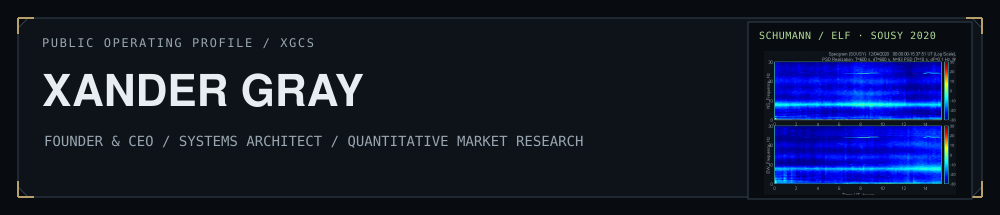
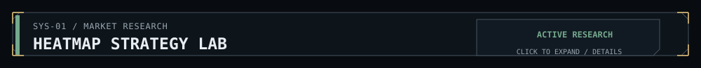
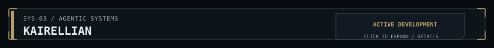
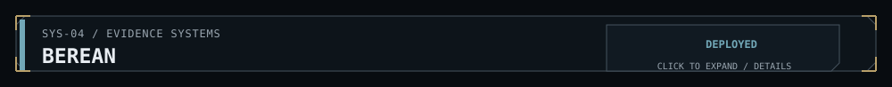
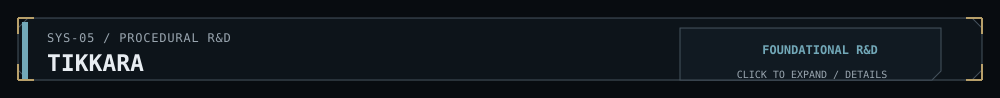
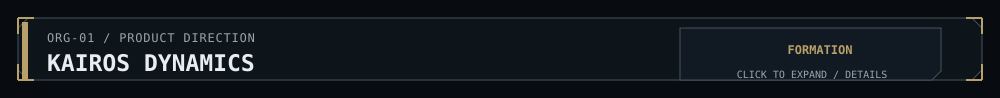
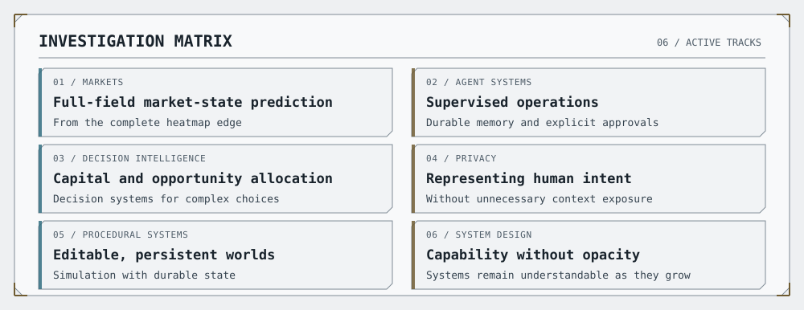
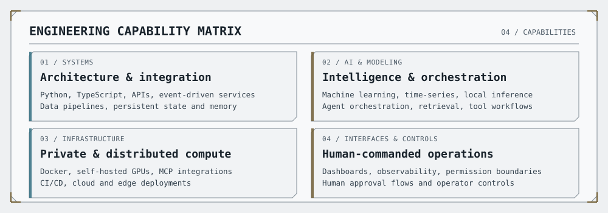
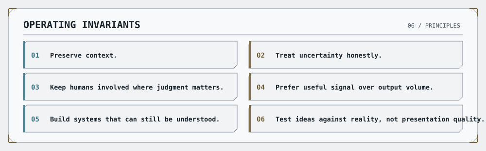

<table>
  <tr>
    <td width="76%" valign="middle">
      
    </td>
    <td width="24%" valign="middle" align="center">
      
      BGS / ESKDALEMUIR · DAILY DATA
    </td>
  </tr>
</table>

  <a href="https://xgcapitalstrategies.com">XG Capital Strategies</a>
  &nbsp;·&nbsp;
  <a href="https://xgcapitalstrategies.com/xg-capital-insights">XG Capital Insights</a>
  &nbsp;·&nbsp;
  <a href="mailto:xander@xgcapitalstrategies.com">Contact</a>

## Mission

I’m the founder and CEO of **XG Capital Strategies**. I build decision systems for markets, capital allocation, network coordination, and problems where the useful signal is distributed across time, people, and imperfect data.

I usually start building when the available tools flatten a problem that needs to be understood as a whole. That has taken me into quantitative market research, machine learning, persistent memory, agent systems, network intelligence, procedural simulation, and self-hosted AI.

The question connecting the work is straightforward:

> **How do you find the signal that matters early enough to act on it?**

## Systems Status

<picture>
  <source media="(prefers-color-scheme: dark)" srcset="assets/systems-dashboard-dark.svg">
  <source media="(prefers-color-scheme: light)" srcset="assets/systems-dashboard-light.svg">
  
</picture>

## Current Operations

SELECT A SYSTEM / EXPAND TO READ ITS BRIEF

`ACTIVE RESEARCH` · `MARKETS` · `MACHINE LEARNING`

A research environment for studying market structure across equities and digital assets. Rather than treating indicators as unrelated lines, the lab represents the market as an evolving, multiscale field built from price, volume, pressure, momentum, and their relationships.

The research spans market-state heatmaps, price and volume semantics, full-field market-state prediction, convolutional and temporal models, walk-forward and out-of-sample validation, and the risk, execution, sizing, and position-management logic required to turn research into a testable system. Human-readable diagnostics remain part of the design, not an afterthought.

<strong>Research focus</strong>

 

- Multiscale price and volume semantics
- Field-state and phase representation
- Full heatmap-edge prediction
- CNN and temporal-model experiments
- Out-of-sample and walk-forward validation
- Risk, sizing, execution, and position management
- Human-readable model diagnostics

`PRIVATE DEVELOPMENT` · `NETWORKS` · `COORDINATION`

Valence is a privacy-first coordination and path-intelligence system for routing people, capital, projects, and opportunities through real-world networks.

The right person, resource, or opportunity often already exists somewhere in the network. The harder problem is preserving enough context to recognize it, representing intent without exposing more than necessary, and finding a trusted path between the relevant parties.

<strong>System direction</strong>

 

- Persistent context and relationship-aware matching
- Consent-based identity reveal
- Privacy-preserving representations of intent
- Path discovery across people and organizations
- Human review for consequential decisions

`ACTIVE DEVELOPMENT` · `AGENTIC SYSTEMS` · `HUMAN CONTROL`

**Kairellian** is a human-commanded agentic operating environment in development under the Kairos Dynamics product direction. The vessel-and-crew metaphor gives people a practical way to understand, direct, and supervise increasingly autonomous work in dataspace.

Its architecture centers on a **Command Bridge** for human oversight, a coordinating AI **First Officer**, and modular systems for memory, communication, research, security, and execution. The immediate engineering focus is **Frigate**, the personal edition, with self-hosted operation, explicit approval boundaries, and visible agent activity. It is in active development, not a publicly launched product.

`DEPLOYED` · `REASONING SYSTEMS`

Berean is an evidence-grounded reasoning system designed to keep source material, interpretation, and conclusion visibly separated. It began as a Scripture-first research tool, but the underlying architecture applies to other domains where claims must be tested against an authoritative corpus.

`FOUNDATIONAL R&D` · `PROCEDURAL SYSTEMS`

Tikkara is a long-horizon experiment in persistent procedural worlds, AI-driven characters, generated assets, editable simulation, and emergent narrative. It connects naturally to the rest of the work: markets, organizations, and simulated worlds all depend on state, memory, incentives, coordination, and change over time.

## Product Direction

`FORMATION` · `DECISION INTELLIGENCE` · `PRODUCT DIRECTION`

**Kairos Dynamics** is the broader emerging product direction for turning research developed through XG Capital Strategies into deployable decision systems. **Kairellian** is one concrete system being built within that direction. Other areas of exploration include market intelligence, strategic research, private AI deployment, capital and opportunity intelligence, and organizational memory. These remain active development and research directions, not claims of commercial validation.

## Current Investigations

<picture>
    <source media="(prefers-color-scheme: dark)" srcset="assets/investigations-dark.svg">
    <source media="(prefers-color-scheme: light)" srcset="assets/investigations-light.svg">
    
  </picture>

Text version of the investigation matrix

- `01` Full-field market-state prediction from the complete heatmap edge
- `02` Supervised agent operations with durable memory and explicit approvals
- `03` Decision intelligence for capital and opportunity allocation
- `04` Privacy-preserving representations of human intent
- `05` Editable procedural worlds with durable state
- `06` Systems that grow more capable without becoming less understandable

## Engineering Profile

<picture>
    <source media="(prefers-color-scheme: dark)" srcset="assets/engineering-dark.svg">
    <source media="(prefers-color-scheme: light)" srcset="assets/engineering-light.svg">
    
  </picture>

Expanded engineering capabilities

- **Systems:** Python, TypeScript, APIs, event-driven services, data pipelines, persistent state and memory
- **AI and modeling:** Applied machine learning, time-series research, local inference, multi-agent orchestration, retrieval and tool-integrated workflows
- **Infrastructure:** Docker, self-hosted GPU compute, MCP integrations, CI/CD, and cloud and edge deployment
- **Interfaces and controls:** Research dashboards, operator interfaces, observability, permission boundaries, and human approval flows

I use **agentic engineering** to design, integrate, test, and operate these systems, with an emphasis on architecture, validation, and making complex behavior understandable to the people directing it.

## Operating Principles

<picture>
    <source media="(prefers-color-scheme: dark)" srcset="assets/principles-dark.svg">
    <source media="(prefers-color-scheme: light)" srcset="assets/principles-light.svg">
    
  </picture>

Operating principles as text

- `01` Preserve context.
- `02` Treat uncertainty honestly.
- `03` Keep humans involved where judgment matters.
- `04` Prefer useful signal over output volume.
- `05` Build systems that can still be understood.
- `06` Test ideas against reality, not presentation quality.

## Public Activity

This profile is a selective view of the systems I work on, not a complete inventory of repositories or release milestones. Much of the active development remains private because it includes proprietary research, sensitive context, and architecture still being validated. I publish public artifacts when they can be understood and evaluated on their own.

Some public and experimental work also appears under [@alexander-the-gray](https://github.com/alexander-the-gray). Both GitHub accounts are operated by me.

## Contact

I’m open to conversations with engineers, researchers, investors, and founders working on difficult problems involving markets, AI, capital, networks, or complex systems.

- [XG Capital Strategies](https://xgcapitalstrategies.com)
- [XG Capital Insights](https://xgcapitalstrategies.com/xg-capital-insights)
- [xander@xgcapitalstrategies.com](mailto:xander@xgcapitalstrategies.com)

Scientific image source and attribution

Daily Schumann-resonance spectrogram: <a href="https://geomag.bgs.ac.uk/research/inductioncoils.html">British Geological Survey (BGS), Eskdalemuir Observatory</a>, North-pointing induction coil, © UKRI 2026. The original chart is linked directly from <a href="https://geomag.bgs.ac.uk/images/currentSpectrogramCH1.jpg">BGS's published daily image</a> without alteration. BGS publishes the previous day's measurements. GitHub may cache the image; check the observation date printed within the chart. This is a single-station observation, not a global scalar index or a continuous real-time reading. Source credit does not imply BGS endorsement.

Animated 30-day history: one reported valid fundamental-frequency reading per UTC day (10 Oct–8 Nov 2026), derived from the openly published <a href="https://ressonanciaschumannhoje.com/dados/historico.json">Ressonância de Schumann Hoje 30-day series</a> based on <a href="https://ressonanciaschumannhoje.com/en/">Tomsk SOS observations</a>. The series is extracted from spectrogram colours; it is not a calibrated field-strength measurement or a reconstructed 30-day spectrogram. Source gaps after 1 Nov are explicitly marked, without interpolation. <a href="assets/schumann-30d-source.json">Snapshot data and method</a>. This graphic is a historical snapshot, not an automatically updating source.

