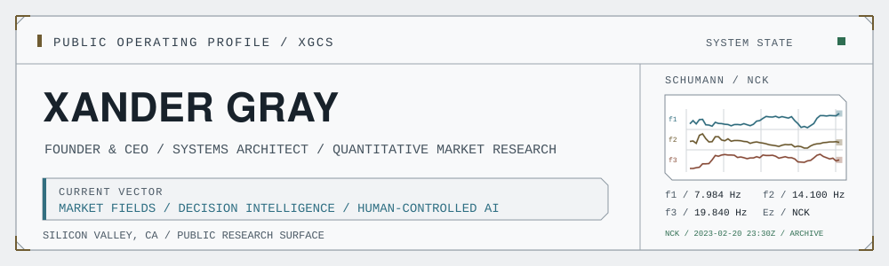
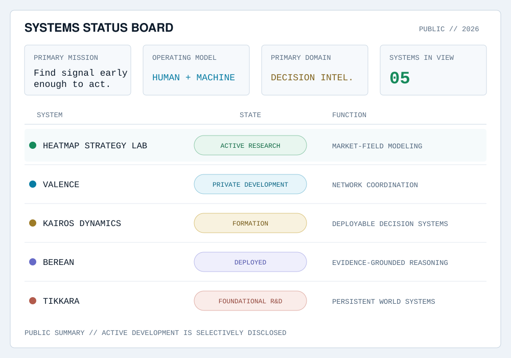

<picture>
  <source media="(prefers-color-scheme: dark)" srcset="assets/command-header-dark.svg">
  <source media="(prefers-color-scheme: light)" srcset="assets/command-header-light.svg">
  
</picture>

  <a href="https://xgcapitalstrategies.com">XG Capital Strategies</a>
  &nbsp;·&nbsp;
  <a href="https://xgcapitalstrategies.com/xg-capital-insights">XG Capital Insights</a>
  &nbsp;·&nbsp;
  <a href="mailto:xander@xgcapitalstrategies.com">Contact</a>

## Mission

I’m the founder and CEO of **XG Capital Strategies**. I build decision systems for markets, capital allocation, network coordination, and problems where the useful signal is distributed across time, people, and imperfect data.

I usually start building when the available tools flatten a problem that needs to be understood as a whole. That has taken me into quantitative market research, machine learning, persistent memory, agent systems, network intelligence, procedural simulation, and self-hosted AI.

The question connecting the work is straightforward:

> **How do you find the signal that matters early enough to act on it?**

## Systems Status

<picture>
  <source media="(prefers-color-scheme: dark)" srcset="assets/systems-dashboard-dark.svg">
  <source media="(prefers-color-scheme: light)" srcset="assets/systems-dashboard-light.svg">
  
</picture>

## Current Operations

### Heatmap Strategy Lab

`ACTIVE RESEARCH` · `MARKETS` · `MACHINE LEARNING`

A research environment for studying market structure across equities and digital assets. Rather than treating indicators as unrelated lines, the lab represents the market as an evolving, multiscale field built from price, volume, pressure, momentum, and their relationships.

The current work spans market-state heatmaps, price and volume semantics, full-field market-state prediction, convolutional and temporal models, walk-forward and out-of-sample validation, and the risk, execution, sizing, and position-management logic required to turn research into a testable system. Human-readable diagnostics remain part of the design, not an afterthought.

<strong>Research focus</strong>

 

- Multiscale price and volume semantics
- Field-state and phase representation
- Full heatmap-edge prediction
- CNN and temporal-model experiments
- Out-of-sample and walk-forward validation
- Risk, sizing, execution, and position management
- Human-readable model diagnostics

### Valence

`PRIVATE DEVELOPMENT` · `NETWORKS` · `COORDINATION`

Valence is a privacy-first coordination and path-intelligence system for routing people, capital, projects, and opportunities through real-world networks.

The right person, resource, or opportunity often already exists somewhere in the network. The harder problem is preserving enough context to recognize it, representing intent without exposing more than necessary, and finding a trusted path between the relevant parties.

<strong>System direction</strong>

 

- Persistent context and relationship-aware matching
- Consent-based identity reveal
- Privacy-preserving representations of intent
- Path discovery across people and organizations
- Human review for consequential decisions

### Kairos Dynamics

`FORMATION` · `DECISION INTELLIGENCE` · `PRODUCT DIRECTION`

Kairos Dynamics is the emerging product direction for turning research developed through XG Capital Strategies into deployable decision systems. The work is forming around market intelligence, strategic research, agentic workflows, private deployment, organizational memory, capital and opportunity intelligence, and human-controlled AI. It is an active direction—not a claim of commercial proof.

### Berean

`DEPLOYED` · `REASONING SYSTEMS`

Berean is an evidence-grounded reasoning system designed to keep source material, interpretation, and conclusion visibly separated. It began as a Scripture-first research tool, but the underlying architecture applies to other domains where claims must be tested against an authoritative corpus.

### Tikkara

`FOUNDATIONAL R&D` · `PROCEDURAL SYSTEMS`

Tikkara is a long-horizon experiment in persistent procedural worlds, AI-driven characters, generated assets, editable simulation, and emergent narrative. It connects naturally to the rest of the work: markets, organizations, and simulated worlds all depend on state, memory, incentives, coordination, and change over time.

## Current Investigations

- `01` Full-field market-state prediction from the complete heatmap edge
- `02` Persistent memory and coordination across agent systems
- `03` Decision intelligence for capital and opportunity allocation
- `04` Privacy-preserving representations of human intent
- `05` Editable procedural worlds with durable state
- `06` Systems that grow more capable without becoming less understandable

## Engineering Profile

- **Systems:** Python, TypeScript, APIs, data pipelines, state and memory systems, event-driven services
- **AI and modeling:** Applied machine learning, computer vision, time-series research, agent orchestration, retrieval systems, local model inference
- **Infrastructure:** Docker, CI/CD, local GPU compute, self-hosted environments, cloud and edge deployment
- **Interfaces:** Research dashboards, market visualizations, intelligence panels, operator-focused interfaces

I’m less interested in collecting technologies than in choosing an architecture that fits the problem and remains legible under pressure.

## Operating Principles

- `01` Preserve context.
- `02` Treat uncertainty honestly.
- `03` Keep humans involved where judgment matters.
- `04` Prefer useful signal over output volume.
- `05` Build systems that can still be understood.
- `06` Test ideas against reality, not presentation quality.

## Public Activity

Most active development remains in private repositories because it includes proprietary research, sensitive context, or early-stage product architecture. Public work is released selectively when it can stand on its own without exposing the parts that should remain private.

Some public and experimental work also appears under [@alexander-the-gray](https://github.com/alexander-the-gray). Both GitHub accounts are operated by me.

## Contact

I’m open to conversations with engineers, researchers, investors, and founders working on difficult problems involving markets, AI, capital, networks, or complex systems.

- [XG Capital Strategies](https://xgcapitalstrategies.com)
- [XG Capital Insights](https://xgcapitalstrategies.com/xg-capital-insights)
- [xander@xgcapitalstrategies.com](mailto:xander@xgcapitalstrategies.com)
